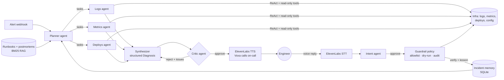

# Voxa: Voice-First Multi-Agent SRE

[](https://github.com/psguerrillagames-lgtm/Voxa-Voice-Agent/actions/workflows/ci.yml)

When a production alert fires, **Voxa calls you first**:

> "Hi, this is Voxa. Checkout latency is up four times since deploy v2.3 twelve minutes ago.
> The logs show the database connection pool is exhausted. Should I roll it back?"

You answer by voice. Behind the call, a team of Claude agents has already investigated
logs, metrics and deploys, checked runbooks and past incidents, and had its diagnosis
reviewed by a critic agent. Nothing that changes production runs without your spoken "yes".

## Architecture



## Agentic AI concepts, and where they live

| Concept | Implementation |
|---|---|
| Tool calling | [`voxa/tools/sre.py`](voxa/tools/sre.py): risk-tagged tools (read / write / destructive) |
| ReAct loop | [`voxa/agents/react.py`](voxa/agents/react.py): reason → act → observe, step budget, `pause_turn` resume |
| Planning | Planner produces hypotheses and per-specialist tasks ([`orchestrator.py`](voxa/agents/orchestrator.py)) |
| Multi-agent | Logs, metrics and deploys specialists run in parallel, each with least-privilege tools |
| RAG | [`voxa/rag.py`](voxa/rag.py): section-chunked runbooks/postmortems, BM25, used up front and as an agent tool |
| Memory | Short-term: call session. Long-term: [`voxa/memory.py`](voxa/memory.py) recalls similar past incidents |
| Reflection | Critic agent rejects diagnoses that blame symptoms or contradict runbooks; synthesizer revises |
| Structured output | Pydantic `Plan`, `Diagnosis`, `Critique`, `ReplyIntent` via `messages.parse` ([`schemas.py`](voxa/schemas.py)) |
| Human-in-the-loop | Only the exact action approved on the call can run ([`session.py`](voxa/session.py)) |
| Guardrails | [`voxa/guardrails.py`](voxa/guardrails.py): allowlist, limits, dry-run, append-only audit log |
| MCP | [`voxa/mcp_server.py`](voxa/mcp_server.py): read-only tools for any MCP client |
| Voice | [`voxa/voice.py`](voxa/voice.py): ElevenLabs streaming TTS and Scribe STT; AI-initiated call |
| Event-driven | `POST /alerts` webhook starts the agent with no human prompt |
| Observability | [`voxa/observability.py`](voxa/observability.py): spans for every LLM/tool step, tokens, cost, live WebSocket trace |
| Evals | [`evals/run_evals.py`](evals/run_evals.py): 20 injected incidents, scored on root cause, category and action |
| Resilience | Server-side refusal fallbacks, tool errors returned to the model instead of crashing |

## Run it

```bash
python -m venv .venv && .venv/Scripts/activate      # macOS/Linux: source .venv/bin/activate
pip install -e ".[dev]"
cp .env.example .env                                 # add ANTHROPIC_API_KEY and ELEVENLABS_API_KEY
uvicorn voxa.server:app --reload
```

Open http://localhost:8000, click a fault (e.g. **bad deploy checkout**), and Voxa calls you.
Hold the mic button to reply, or type. Without an ElevenLabs key the call works as text.

`VOXA_DRY_RUN=true` (default) simulates actions; set it to `false` to let approved actions
change the simulated environment and watch the service recover.

Docker: `docker compose up --build`

MCP (e.g. add to Claude Desktop / Claude Code):

```bash
python -m voxa.mcp_server --scenario bad_deploy_checkout
```

## Evals

```bash
python evals/run_evals.py              # 20 cases, with critic
python evals/run_evals.py --no-critic  # ablation
```

Each of five fault types (bad deploy, memory leak, config error, traffic spike, third-party
outage) is injected into four different services, most with red herrings such as gateway
latency or an unrelated recent deploy. A case passes only if the root-cause service, the
fault category and the remediation are all correct.

| Run | Cases | Root cause | Category | Action | All three |
|---|---|---|---|---|---|
| with critic | 20 | _run evals_ | | | |
| no critic | 20 | _run evals_ | | | |

## Tests

```bash
pytest -q        # 31 offline tests; a scripted fake LLM stands in for Claude
```

## Project layout

```
voxa/
  agents/        react loop, orchestrator, prompts
  sim/           simulated infra + fault scenarios with ground truth
  tools/         SRE tools and tool runner
  llm.py         Claude client (adaptive thinking, effort, fallbacks, tracing)
  rag.py         runbook retrieval        memory.py   incident memory
  guardrails.py  action policy            session.py  the voice call state machine
  voice.py       ElevenLabs               server.py   FastAPI + WebSocket
  mcp_server.py  MCP server
data/            runbooks and postmortems
evals/           benchmark runner
web/             dashboard
```

## License

MIT
